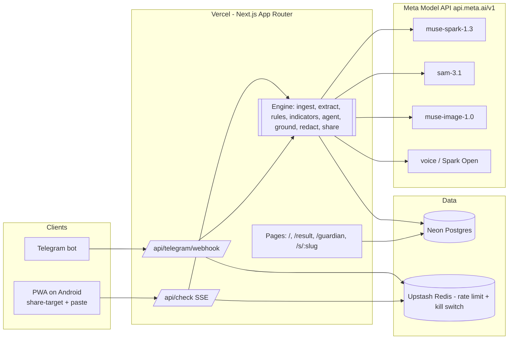
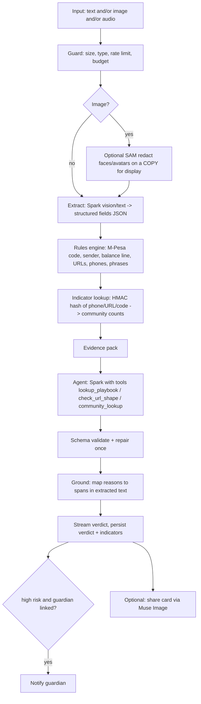
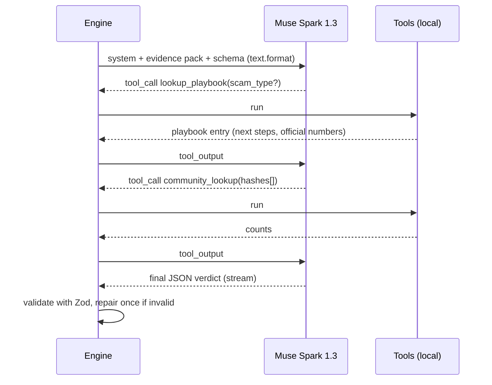

# 03 — Architecture (the file that matters most)

## 1. Design principles

1. **Deterministic first, model second.** Meta's `tool_choice` supports only `"auto"` [VERIFIED], so you cannot force a tool call. Run all Kenya-specific checks in code *before* the model; give the model an **evidence pack**. Result: cheaper, more reliable, testable.
2. **One engine, many doors.** PWA, Telegram bot and (later) anything else call the same `runCheck()` function.
3. **Schema or nothing.** Model output must validate against a JSON schema (Zod). Invalid → one repair retry → "unclear".
4. **Store the minimum.** Verdicts + HMAC-hashed indicators. No message bodies, no images persisted after processing.
5. **Provider-agnostic model client.** `src/lib/meta.ts` is the only file that knows the base URL and model ID. This enables the open-weights bonus and fallbacks.
6. **Budget is a feature.** Every model call is logged with token usage and cost; a daily kill-switch protects the $150.

## 2. System context



## 3. The check pipeline



### Stages in detail

| Stage | Input → Output | Model? | Notes |
|---|---|---|---|
| Guard | request → ok/429 | no | Upstash sliding window (device + IP), daily $ cap, body ≤ 12 KB text / 5 MB image |
| Extract | text/image → `Extraction` JSON | Spark (cheap config) | Text-only input skips the model: regex + small prompt only if messy |
| Rules | `Extraction` → `RuleFindings[]` | no | Pure TypeScript, unit-tested (§5) |
| Indicators | normalised values → counts | no | HMAC-SHA256 with server pepper; see file 05 |
| Agent | evidence pack → `Verdict` | Spark (reasoning effort medium) | Max 3 tool turns; strict schema output |
| Ground | verdict reasons → character spans | no (string match) | Highlights must reference real substrings of extracted text, else drop highlight |
| Persist | verdict, indicators | no | No body; `check_indicators` link rows |
| Notify | guardian | no | Telegram `sendMessage` or in-app inbox row |

## 4. Agent loop (Responses API)



Rules:
- **Tools are read-only** (default-deny philosophy carried from your earlier platform work, reimplemented here): `lookup_playbook`, `check_url_shape`, `community_lookup`. No network, no writes, no arbitrary code.
- Max 3 tool iterations, 25 s overall timeout (`AbortController`), then fall back to rules-only verdict.
- `web_search` tool exists (Responses-only, $2.50/1k queries). **Do not use in MVP**: it adds cost, latency and prompt-injection surface from the open web.
- Prompt-injection stance: message content is *untrusted data*. System prompt says so; content is wrapped in delimiters; the model has no tool that can act on instructions in the content.

## 5. Rules engine (the unfair advantage)

All in `src/engine/rules/*.ts`, each rule returns `{id, severity, weight, evidence, span?}`.

| Rule ID | Check | Weight |
|---|---|---|
| R01 `mpesa_code_format` | 10 chars, `[A-Z0-9]`, starts with valid year letter (year = 2005 + index; T=2025, U=2026), 2nd char month A–L, 3rd char day (1–9, then A–V = 10–31). Date must be ≤ today and not in the past >2 yrs | high if fails |
| R02 `sender_not_mpesa` | Message claims "Confirmed… M-Pesa" but sender ≠ `MPESA` (only if sender provided / visible in screenshot) | high |
| R03 `balance_line_missing` | Real confirmations carry "M-PESA balance is Ksh…" and "Transaction cost". Missing/"LOCKED" → suspicious | high |
| R04 `reversal_script` | "sent by mistake / tumetuma kimakosa / please reverse / rudisha" | high |
| R05 `urgency_pressure` | "within 30 minutes / immediately / account will be blocked / haraka" | medium |
| R06 `send_to_other_number` | "tuma kwa hii number / send to 07…" with a number ≠ sender | medium |
| R07 `url_shape` | Shorteners, lookalike domains of safaricom/mpesa/kra/ecitizen, IP hosts, `.xyz/.top` TLDs, punycode | high/medium |
| R08 `fee_to_unlock` | Pay registration/processing/"fee" for job, loan or prize | high |
| R09 `prize_or_cashback` | "You won / cashback / bonus" without verifiable context | medium |
| R10 `otp_pin_request` | Asks for PIN/OTP/ID | **critical** |
| R11 `investment_returns` | Guaranteed returns, "AI trading", "double your money" | high |
| R12 `fake_customer_care` | "Safaricom customer care calling…" + request to send/confirm code | high |
| R13 `amount_mismatch` | Amounts differ within the same message | medium |
| R14 `tone_uppercase_symbols` | Excessive caps/emoji urgency | low |

Rule outcomes feed:
1. the evidence pack (so the model sees them with IDs),
2. a **prior risk score** (weighted sum → 0–100),
3. a **floor**: if any `critical` fires the final verdict cannot be below `high`.

The model may *raise* or *explain*; it may **not lower** below a rule floor without citing a counter-rule ("Genuine sender 'MPESA' + valid code + balance line present"). This stops the model being talked into "safe" by a persuasive scam.

### M-Pesa code validator (TypeScript sketch)

```ts
const YEAR_BASE = 2005; // A=2005 ... T=2025, U=2026  [derived from press explainer, TEST on real SMS]
export function parseMpesaCode(code: string, now = new Date()) {
  if (!/^[A-Z0-9]{10}$/.test(code)) return { ok: false, reason: "format" };
  const y = YEAR_BASE + (code.charCodeAt(0) - 65);
  const m = code.charCodeAt(1) - 65; // A..L => 0..11
  const dch = code[2];
  const d = /[1-9]/.test(dch) ? Number(dch) : 10 + (dch.charCodeAt(0) - 65); // A=10 ... V=31
  if (m < 0 || m > 11 || d < 1 || d > 31) return { ok: false, reason: "date-range" };
  const dt = new Date(Date.UTC(y, m, d));
  if (dt.getUTCMonth() !== m) return { ok: false, reason: "date-invalid" };
  if (dt > now) return { ok: false, reason: "future" };
  return { ok: true, date: dt };
}
```
Check: 27 Oct 2026 → year `U`, month `J` (Oct = index 9 → J), day 27 = 10 + 17 → `R` → **`UJR`**. If your real SMS today does not start `UJR`, fix the table before trusting R01. (Treat R01 as *supporting* evidence until validated; severity "medium" if unvalidated.)

## 6. Streaming design

- `POST /api/check` returns `text/event-stream` (SSE). Events: `stage` (`extracting|rules|reasoning`), `rules` (findings), `token` (optional partial reasons), `verdict` (final JSON), `done`, `error`.
- UI shows stage chips immediately (perceived speed) and populates highlights as soon as `rules` arrives (≈1 s), before the model finishes.
- Vercel Hobby: set `export const maxDuration = 60` (limit is 300 s with Fluid compute [VERIFIED]); our target is <10 s.
- Reconnect: `GET /api/checks/:id` returns the final record if SSE drops.

## 7. Privacy architecture

| Data | Where | Retention |
|---|---|---|
| Raw text/image | In-memory only, request scope | Discarded when request ends |
| Extracted fields | Not stored (only hashes) | — |
| Indicators (phone, URL host, code pattern) | `indicators.hash` = HMAC-SHA256(pepper, normalised value) | 180 days |
| Verdict (risk, type, reasons text, language) | `checks` | 30 days default, user can delete now |
| Redacted thumbnail | Optional, off by default | — |
| Telegram chat ID | `identities` (encrypted at rest by DB; AES-GCM column optional) | Until unlink |
| Model provider | **Standard** model IDs only (not `-contributor`) for user data | Ask Meta about retention in Discord |

Reasons text is generated by the model and may echo parts of the message; instruct "paraphrase, never quote phone numbers/names". Run `redact.ts` (regex mask for phones, ID numbers, emails) on `reasons` before persist.

## 8. Failure modes & degradation

| Failure | Detect | Behaviour |
|---|---|---|
| Meta API 429/5xx | status | Retry once with jitter; then rules-only verdict labelled "Quick check (AI unavailable)" |
| Timeout >25 s | AbortController | Same as above |
| Invalid JSON | Zod fail | One repair call (`temperature 0`), else rules-only |
| Budget kill-switch tripped | Redis flag | Show "Hakiki is resting, try tomorrow", still run rules-only for text |
| SAM fails | catch | Skip redaction; never block the verdict |
| Image unreadable | extraction empty | Ask user to retake / paste text |
| DB down | catch | Return verdict, skip persist, `X-Persisted: false` |
| Prompt injection in message | validator + floors | Floors prevent lowering; schema prevents free text actions |

## 9. Module layout

```
hakiki/
  src/
    app/                      # Next.js routes
      page.tsx                # home: paste/upload
      result/[id]/page.tsx
      guardian/page.tsx
      s/[slug]/page.tsx       # public share page
      api/check/route.ts      # SSE
      api/checks/route.ts, api/checks/[id]/route.ts
      api/checks/[id]/feedback/route.ts
      api/guardians/invite/route.ts, accept/route.ts
      api/telegram/webhook/route.ts, link/route.ts
      api/health/route.ts
      manifest.webmanifest/route.ts  # share_target
    engine/
      ingest.ts  extract.ts  indicators.ts  agent.ts  ground.ts  redact.ts  share.ts
      rules/index.ts, mpesa.ts, url.ts, phrases.ts, phone.ts
      schemas.ts              # Zod: Extraction, RuleFinding, Verdict
    lib/ meta.ts db/ auth.ts ratelimit.ts budget.ts i18n/{en,sw}.json
    bot/ telegram.ts
  data/playbook/*.json        # scam types, next steps, official numbers
  evals/ cases.jsonl run.ts report.md
  docs/                       # this pack
  CLAUDE.md
```

## 10. Scaling / cost thoughts (for the README, short)

Stateless functions, Postgres pooled (Neon), Redis for limits. Cost per check ~$0.015–0.03 (estimate; measure). A per-check cap of `max_output_tokens` 900 and a cached static prefix (system prompt + playbook first, user content last) keep it down.

## 11. Architecture decision records (put in `docs/DECISIONS.md`)

| ADR | Decision | Alternative rejected | Reason |
|---|---|---|---|
| 1 | Rules before model | Pure LLM | Cheaper, testable, can't be talked down |
| 2 | Responses API + `text.format` | Chat Completions | Meta recommends it; tools + structured output together |
| 3 | No message storage | Store for training | Trust + DPA |
| 4 | Telegram not WhatsApp | WhatsApp Business API | Verification time exceeds 8 days |
| 5 | Anonymous sessions | Mandatory signup | Demo friction |
| 6 | Single Next.js app | Separate API service | One deploy, less glue |
