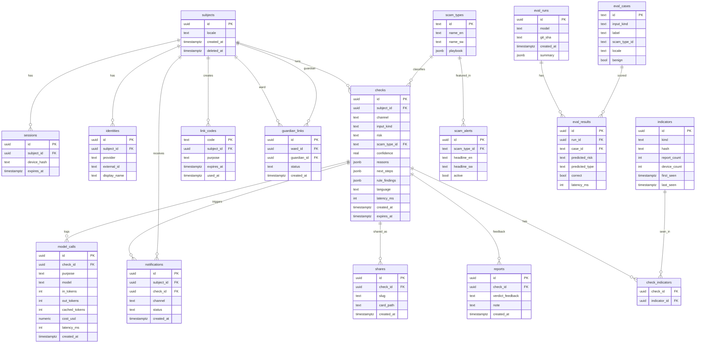

# 05 — Database: ERD, DDL, indexes, retention

Postgres (Neon). IDs: `uuid` (gen_random_uuid()). Timestamps `timestamptz`. **No message bodies or images are stored.**

## 1. ERD



Note: eval case *inputs* live in `evals/cases.jsonl` in the repo (synthetic, no real victims' data); the DB only holds metadata/results.

## 2. DDL

```sql
create extension if not exists pgcrypto;

create table subjects (
  id uuid primary key default gen_random_uuid(),
  locale text not null default 'en' check (locale in ('en','sw')),
  created_at timestamptz not null default now(),
  deleted_at timestamptz
);

create table sessions (
  id uuid primary key default gen_random_uuid(),
  subject_id uuid not null references subjects(id) on delete cascade,
  device_hash text not null,                    -- HMAC(pepper, ua+ip-prefix) for abuse limits only
  created_at timestamptz not null default now(),
  expires_at timestamptz not null
);
create index on sessions (subject_id);

create table identities (
  id uuid primary key default gen_random_uuid(),
  subject_id uuid not null references subjects(id) on delete cascade,
  provider text not null check (provider in ('telegram','email')),
  external_id text not null,                    -- telegram chat id / email
  display_name text,
  created_at timestamptz not null default now(),
  unique (provider, external_id)
);

create table link_codes (
  code text primary key,                        -- 8 chars, unambiguous alphabet
  subject_id uuid not null references subjects(id) on delete cascade,
  purpose text not null check (purpose in ('telegram_link','guardian_invite')),
  expires_at timestamptz not null,
  used_at timestamptz
);

create table guardian_links (
  id uuid primary key default gen_random_uuid(),
  ward_id uuid not null references subjects(id) on delete cascade,
  guardian_id uuid not null references subjects(id) on delete cascade,
  status text not null default 'active' check (status in ('pending','active','revoked')),
  share_level text not null default 'summary' check (share_level in ('summary')),
  created_at timestamptz not null default now(),
  unique (ward_id, guardian_id)
);

create table scam_types (
  id text primary key,                          -- e.g. fake_reversal
  name_en text not null,
  name_sw text not null,
  playbook jsonb not null                       -- next steps, official numbers
);

create table checks (
  id uuid primary key default gen_random_uuid(),
  subject_id uuid not null references subjects(id) on delete cascade,
  channel text not null check (channel in ('web','telegram','share')),
  input_kind text not null check (input_kind in ('text','image','text_image','audio')),
  risk text not null check (risk in ('safe','suspicious','high','unclear')),
  scam_type_id text references scam_types(id),
  confidence real not null check (confidence between 0 and 1),
  reasons jsonb not null,                       -- [{text, rule_id?, severity}] paraphrased, redacted
  next_steps jsonb not null,
  rule_findings jsonb not null,                 -- [{id, severity, weight}] no raw content
  language text not null,
  latency_ms int,
  created_at timestamptz not null default now(),
  expires_at timestamptz not null default (now() + interval '30 days')
);
create index checks_subject_created on checks (subject_id, created_at desc);
create index checks_expires on checks (expires_at);

create table indicators (
  id uuid primary key default gen_random_uuid(),
  kind text not null check (kind in ('phone','url_host','mpesa_code_pattern','sender','paybill_till')),
  hash text not null,                           -- HMAC-SHA256(pepper, normalised value) hex
  report_count int not null default 0,
  device_count int not null default 0,
  first_seen timestamptz not null default now(),
  last_seen timestamptz not null default now(),
  unique (kind, hash)
);
create index indicators_last_seen on indicators (last_seen);

create table check_indicators (
  check_id uuid not null references checks(id) on delete cascade,
  indicator_id uuid not null references indicators(id) on delete cascade,
  primary key (check_id, indicator_id)
);

-- distinct devices per indicator (for the >=2 devices rule) without storing identity
create table indicator_devices (
  indicator_id uuid not null references indicators(id) on delete cascade,
  device_hash text not null,
  primary key (indicator_id, device_hash)
);

create table reports (
  id uuid primary key default gen_random_uuid(),
  check_id uuid not null references checks(id) on delete cascade,
  verdict_feedback text not null check (verdict_feedback in ('correct','wrong_scam','wrong_safe','unsure')),
  note text,
  created_at timestamptz not null default now()
);

create table shares (
  id uuid primary key default gen_random_uuid(),
  check_id uuid not null references checks(id) on delete cascade,
  slug text not null unique,
  card_path text,
  created_at timestamptz not null default now()
);

create table scam_alerts (
  id uuid primary key default gen_random_uuid(),
  scam_type_id text not null references scam_types(id),
  headline_en text not null,
  headline_sw text not null,
  active boolean not null default true,
  created_at timestamptz not null default now()
);

create table notifications (
  id uuid primary key default gen_random_uuid(),
  subject_id uuid not null references subjects(id) on delete cascade,   -- recipient (guardian)
  check_id uuid not null references checks(id) on delete cascade,
  channel text not null check (channel in ('telegram','inbox')),
  status text not null default 'pending' check (status in ('pending','sent','failed','read')),
  created_at timestamptz not null default now()
);

create table model_calls (
  id uuid primary key default gen_random_uuid(),
  check_id uuid references checks(id) on delete set null,
  purpose text not null,                        -- extract|agent|repair|sam|image|voice
  model text not null,
  in_tokens int, out_tokens int, cached_tokens int,
  cost_usd numeric(10,6) not null default 0,
  latency_ms int,
  created_at timestamptz not null default now()
);
create index model_calls_day on model_calls (created_at);

-- evals
create table eval_cases (
  id text primary key, input_kind text not null, label text not null,
  scam_type_id text, locale text not null default 'en', benign boolean not null default false
);
create table eval_runs (
  id uuid primary key default gen_random_uuid(), model text not null, git_sha text,
  created_at timestamptz not null default now(), summary jsonb
);
create table eval_results (
  id uuid primary key default gen_random_uuid(),
  run_id uuid not null references eval_runs(id) on delete cascade,
  case_id text not null references eval_cases(id),
  predicted_risk text, predicted_type text, correct boolean, latency_ms int
);
```

## 3. Indicator hashing (how the community signal stays private)

```ts
import { createHmac } from "crypto";
export const hashIndicator = (kind: string, raw: string) =>
  createHmac("sha256", process.env.INDICATOR_PEPPER!).update(kind + "|" + normalise(kind, raw)).digest("hex");
// normalise: phone -> E.164 (+2547XXXXXXXX), url -> lowercase registrable host, code -> first 3 chars pattern
```
Upsert on check: increment `report_count`; insert `(indicator_id, device_hash)` and recompute `device_count`. UI shows community numbers only when `report_count >= 3 AND device_count >= 2`.

## 4. Seed data

`data/playbook/*.json` → `scam_types` rows (16 types, file 09 §4). Seed script: `pnpm db:seed`.

## 5. Retention & deletion

| Item | Rule |
|---|---|
| `checks` | `expires_at` = 30 days; nightly job (Vercel cron) `delete from checks where expires_at < now()` |
| `indicators` | Delete when `last_seen < now() - interval '180 days'` |
| `model_calls` | Keep 90 days |
| User "delete my data" | Delete subject → cascades sessions, identities, checks, links, notifications |
| Takedown (indicator) | Admin script sets `report_count = 0` and adds to `indicator_blocklist` (optional table) |

## 6. Drizzle

Mirror the DDL in `src/lib/db/schema.ts`; run `drizzle-kit generate` then `migrate` against Neon. Keep SQL migrations in git. Ask Claude Code: "Create Drizzle schema equivalent to docs/05 §2; don't change names."
