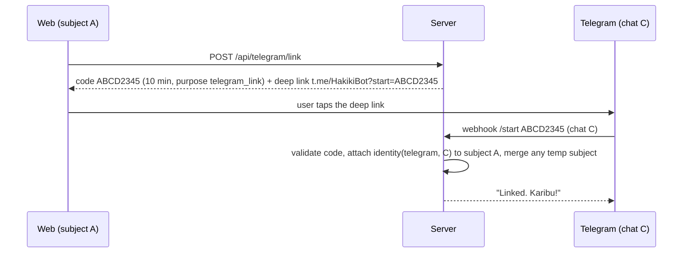

# 06 — Auth, Identity, Guardians, Abuse & Budget Control

## 1. Principles
- **Anonymous-first.** The demo must work with zero signup. A judge opens the link and checks a message in 10 seconds.
- **Identity is optional and additive.** Telegram link and guardian links upgrade a subject; they never gate the hero flow.
- **Least data.** No phone number required. No password. No email in MVP.

## 2. Session model

1. First request without cookie → create `subjects` row + `sessions` row, set cookie `hk_session` (JWT HS256 via `jose`: `{sid, sub, exp}`), `HttpOnly; Secure; SameSite=Lax; Path=/; Max-Age=90 days`.
2. `device_hash = HMAC(pepper, userAgent + ipPrefix)`. Used only for rate limiting and distinct-device counts, never shown.
3. Middleware `getSubject(req)` returns the subject or creates one. Telegram requests resolve the subject via `identities(provider='telegram', external_id=chat_id)`; unknown chat → new subject + identity.
4. `delete my data` → soft-delete flag then hard-delete job; cookie cleared.

## 3. Linking Telegram ↔ web (so history is one timeline)

Code alphabet excludes `0 O 1 I L`. Single use. Rate-limit `/start` attempts (5/min/chat).

## 4. Guardian mode

| Step | Action | Rules |
|---|---|---|
| 1 | Ward creates invite (`link_codes.purpose='guardian_invite'`) | Code valid 24 h |
| 2 | Guardian opens `/guardian/accept?code=…` (or sends code to the bot) | Needs a subject (anonymous is fine) and a notification channel (Telegram or in-app inbox) |
| 3 | `guardian_links` row `active` | Ward sees "Faith can see your high-risk checks" with a revoke button |
| 4 | Ward runs a check; if `risk in ('high')` (and optionally `suspicious`) → notification | Message contains **scam type + risk + time only**; no phone numbers, no message text |
| 5 | Ward revokes any time | Row `revoked`; no further notifications |

Consent copy (EN/SW) is shown to the ward before step 3. Guardian never sees message content. This is both the privacy design and a selling point ("protect without spying").

## 5. Authorisation matrix

| Resource | Owner | Guardian | Anyone with link | Anonymous other |
|---|---|---|---|---|
| `/api/checks/:id` | ✅ | ❌ | ❌ | ❌ |
| Guardian inbox items | — | ✅ (summary only) | ❌ | ❌ |
| `/s/:slug` share page | ✅ | ✅ | ✅ (card only, no PII) | ✅ |
| `/api/admin/*` | Admin token only | — | — | — |

All reads use `where subject_id = $current` in the query itself (never filter in app code after fetching).

## 6. Rate limits (Upstash)

| Limit | Value | Key |
|---|---|---|
| Checks per device | 10 / hour, 40 / day | `device_hash` |
| Checks per IP | 30 / hour | IP |
| Guardian invites | 5 / day | subject |
| Telegram messages | 20 / hour | chat id |
| Image size | ≤ 5 MB, ≤ 1600 px longest side | server check |
| Text size | ≤ 4,000 chars | server check |

**Judge mode:** a secret code (`JUDGE_CODE`, in the submission notes) raises the device limit to 100/day and unlocks the sample gallery. Do not publish it in the repo.

## 7. Budget kill-switch (protects your $150)

- Every model call writes `model_calls.cost_usd` and increments Redis counter `spend:YYYY-MM-DD` (and `spend:total`).
- `assertBudget()` runs at the top of `/api/check`:
  - `spend:today ≥ DAILY_CAP_USD` (default **$6**) → rules-only mode + banner.
  - `spend:total ≥ TOTAL_CAP_USD` (default **$40** for runtime, leaving the rest for dev/evals) → rules-only until you raise it.
- Admin endpoint `POST /api/admin/budget` (Bearer `ADMIN_TOKEN`) to raise/lower caps.
- Also set Meta's console **Spend Limit notification** — it is only a notification, not a cap [VERIFIED].

## 8. Abuse & safety

| Threat | Control |
|---|---|
| Bot floods | Rate limits + optional Cloudflare Turnstile on first anonymous check (add only if abused) |
| Prompt injection inside scam text | Content wrapped as untrusted, rule floors, schema output, no action tools |
| Using Hakiki to *craft* scams ("make my SMS look genuine") | System prompt refuses; verdict-only product; no free-form generation endpoint |
| Fake community reports to smear a number | Threshold ≥3 reports and ≥2 devices; one report per device per indicator; wording "reported by N people" |
| Data subject requests | Delete button + email in privacy page |
| Secrets leak | `.env*` ignored; `gitleaks` pre-commit; keys only in Vercel env |
| Admin access | `ADMIN_TOKEN` 32+ random chars; endpoints return 404 without it |

## 9. Env vars (names only)

`MODEL_API_KEY, MODEL_BASE_URL, MODEL_ID, DATABASE_URL, UPSTASH_REDIS_REST_URL, UPSTASH_REDIS_REST_TOKEN, SESSION_SECRET, INDICATOR_PEPPER, TELEGRAM_BOT_TOKEN, TELEGRAM_WEBHOOK_SECRET, ADMIN_TOKEN, JUDGE_CODE, DAILY_CAP_USD, TOTAL_CAP_USD, APP_URL`
