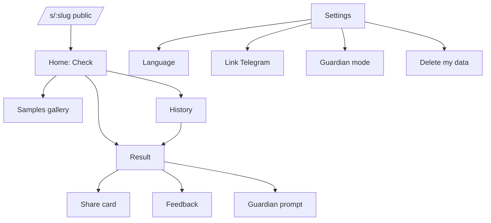
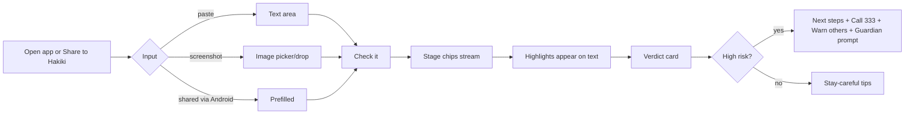

# 08 — UX Flows & Wireframes

## 1. Information architecture


Bottom nav (mobile): **Check · History · Protect · Settings**. 4 items max.

## 2. Primary flow: check a message



## 3. Wireframes (mobile 360 px)

### 3.1 Home
```
┌────────────────────────────┐
│ ◈ hakiki          EN | SW  │
│                            │
│ Check before you send.     │
│ Paste a message or share   │
│ a screenshot.              │
│ ┌────────────────────────┐ │
│ │ Paste the message here │ │
│ │                        │ │
│ └────────────────────────┘ │
│ [ 📷 Upload screenshot ]   │
│ [        Check it        ] │
│                            │
│ Try a sample:              │
│ (Sent by mistake) (Job fee)│
│ (Fake M-Pesa SMS) (Prize)  │
│ We don't keep your message │
│ ─────────────────────────  │
│ Check  History  Protect  ⚙ │
└────────────────────────────┘
```

### 3.2 Checking (streaming)
```
│ ● Reading the message…  ✓  │
│ ● Running Kenya checks… ✓  │
│ ○ Thinking it through…     │
│ Message                    │
│ "Confirmed. Sh15,000 sent  │
│  to you by [mistake],      │
│  [please reverse] to 07.." │   ← highlights appear as rules fire
```

### 3.3 Result (high risk)
```
│ 🛑 LIKELY A SCAM           │
│ Fake reversal scam         │
│ Confidence: High           │
│ ── Why ────────────────    │
│ • Sender isn't "MPESA"     │
│ • No M-Pesa balance line   │
│ • Pressure to "reverse"    │
│ ── Do this now ────────    │
│ 1 Don't send money back    │
│ 2 Check your real balance  │
│ 3 Forward SMS to 333       │
│ [📞 Call 333] [📤 Warn others] │
│ 14 people reported this    │
│ number this week           │
│ Was this right? 👍 👎      │
│ Hakiki can be wrong. …     │
```

### 3.4 Result (unclear)
```
│ ❔ CAN'T TELL YET          │
│ We need more: the sender   │
│ name and the full SMS.     │
│ [Add screenshot]           │
```

### 3.5 Protect (guardian)
```
│ Protect someone you love   │
│ [Invite a guardian]  code: K7MH-2QXD (24h) │
│ You are guarding: Mama (2 alerts this week)│
│ Alerts show risk level only.│
```

### 3.6 Settings
Language, link Telegram (shows code + deep link), guardian list with revoke, delete my data (confirm sheet), privacy notice, about/open-source.

## 4. States checklist (design each)

| Screen | Empty | Loading | Error | Offline |
|---|---|---|---|---|
| Home | sample chips | — | file too big / unsupported | banner "No internet" |
| Result | — | stage chips | "AI unavailable, quick check shown" | cached result readable |
| History | "No checks yet" | skeleton | retry | cached list |
| Guardian | invite CTA | — | code expired | — |

## 5. Android share-target (PWA)

`manifest.webmanifest`:
```json
{
  "name": "Hakiki", "short_name": "Hakiki", "start_url": "/", "display": "standalone",
  "background_color": "#FAF8F4", "theme_color": "#0F6B4F",
  "icons": [{"src":"/icon-192.png","sizes":"192x192","type":"image/png"},{"src":"/icon-512.png","sizes":"512x512","type":"image/png","purpose":"any maskable"}],
  "share_target": {
    "action": "/share", "method": "POST", "enctype": "multipart/form-data",
    "params": { "title": "title", "text": "text", "url": "url",
      "files": [{ "name": "media", "accept": ["image/*"] }] }
  }
}
```
`/share` route handler receives the POST, stashes text/file in memory/IndexedDB via redirect to `/?shared=1`, and auto-focuses "Check it". Requires the PWA to be **installed** on Android Chrome for it to appear in the share sheet. Test this on a real phone; record it for the video.

## 6. Telegram bot scripts

| Trigger | Bot reply |
|---|---|
| `/start` | "Karibu Hakiki 👋 Tuma ujumbe au picha ya skrini unayoshuku. / Send me a suspicious message or screenshot." + language buttons |
| text message | "Inakagua… / Checking…" (edit message as stages complete) → final verdict message |
| photo | Same; ask for original (uncompressed) if text unreadable |
| `/lang` | Toggle EN/SW |
| `/link CODE` or deep link | Link to web account |
| `/guardian` | Show invite code or list |
| `/delete` | Confirm → delete data |

Verdict message format:
```
🛑 *Huenda ni utapeli* — Fake reversal
• Sender si "MPESA"
• Hakuna salio la M-Pesa
• Wanakusukuma "kurudisha"
Cha kufanya: 1) Usirudishe pesa 2) Angalia salio 3) Tuma SMS kwa 333
Maelezo kamili: https://…/result/<id>
```
Telegram message ≤ 4096 chars. Use MarkdownV2 escaping or HTML parse mode (safer).

## 7. Interaction details

- Highlights: tap a reason → scrolls and flashes the matching span.
- "Warn others" opens the native share sheet (`navigator.share`) with the card image + link; fallback = download.
- Language auto-detect: if >40% Swahili tokens, answer SW; user toggle overrides.
- Haptic on high-risk result (`navigator.vibrate(40)`).
- Sample gallery items are **synthetic** scams (clearly marked "Sample") so judges can test instantly.

## 8. Usability test (do it Day 6, 30 min)

Ask 3 people (ideally one 50+): "You get this SMS. What do you do?" Watch where they hesitate. Fix the top 2 issues. Put one quote in the video if they permit.
